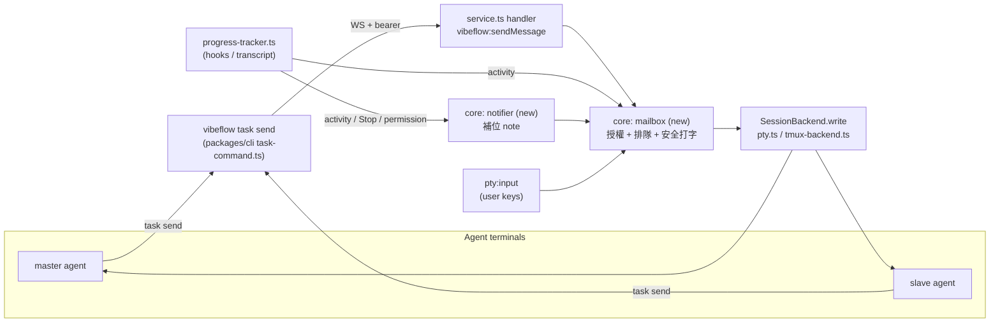
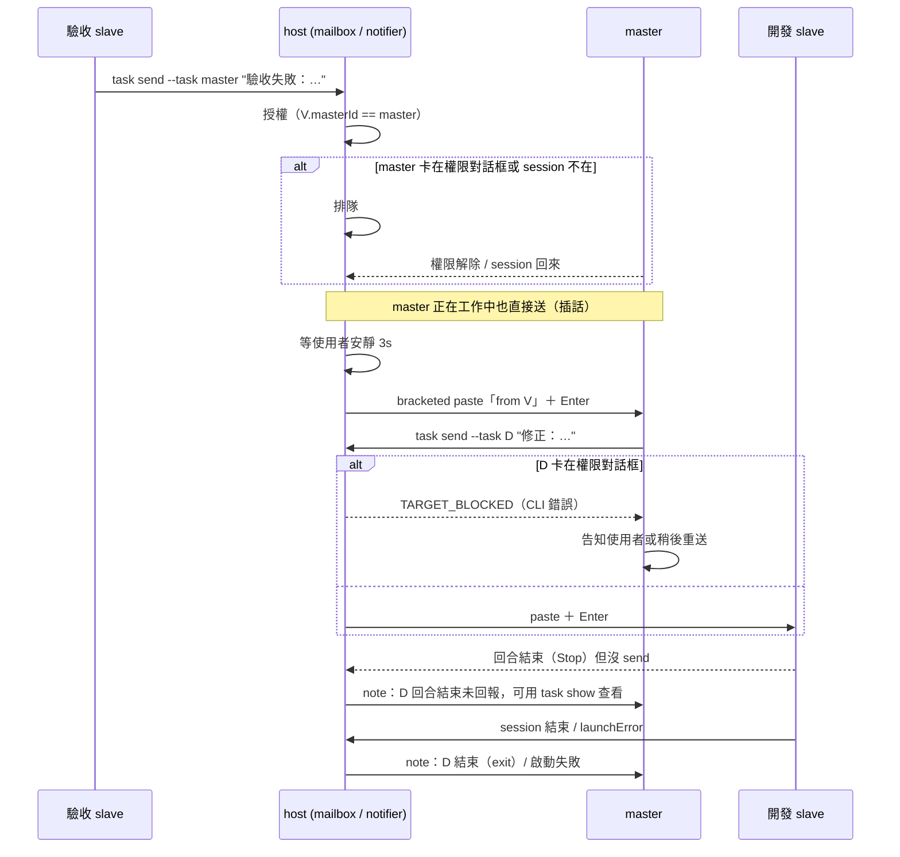

# PLAN — Master ↔ Slave 主動回報與安全打字

> 分支：`feature-master-push-notes`（從 `origin/main` a9d9b73 開出）
> 延續 `docs/features/master-cards/spec.md` 的決策 D2「第二階段：host 把 slave 事件推進 master terminal」。

## 需求

**目的**：現在 master 只能定期跑 `task list` 去「問」每張 slave 的狀態，卡片之間沒有任何方向能傳話，所以「驗收 agent 發現問題 → 開發 agent 修正」這種來回只能靠使用者轉述。這次要讓 host 成為 master 與 slave 之間的郵差：slave 做完自己回報，回報不出來的狀況（卡在權限、啟動失敗、session 結束、做完卻忘了回報）由 host 代為通知。master 也能把話傳回任一張自己的 slave。送進去的方式是把文字「打」進對方 terminal，所以必須保證不會打進權限對話框、不會跟使用者正在打的字混在一起、不會被當成多行逐行送出。使用者因此只需要跟 master 溝通，master 負責分派、轉傳與掌握進度，PR 也由 master 決定時機、交代開發 slave 去開。

R1. 呼叫者是 master 時，`task create` 沒帶 `--master` 也會把新卡掛到呼叫者底下；呼叫者不是 master 或沒有 `VIBEFLOW_TASK_ID` 時行為不變。
R2. 有 master 的 slave 啟動時，agent 拿得到 master 的 task id（環境變數），system prompt 也會告訴它怎麼回報、什麼時候回報。
R3. 新增 `task send --task <id> --text <text> [--force]`，經由 host 把文字送進目標卡的 agent terminal；只允許「master → 自己的 slave」與「slave → 自己的 master」，其他組合一律拒絕並回傳明確錯誤碼。
R4. 送進去的文字包上寄件者標記，收件 agent 看得出是哪張卡（id 與標題）送的；人從 UI 打的字不加標記。
R5. 目標 agent 正卡在權限對話框（`waitingFor: 'permission'`）時，`task send` 拒絕送出；帶 `--force` 才送。
R6. 使用者最後一次在目標 terminal 按鍵後，要安靜滿 3 秒（可用環境變數調整）才送出；在那之前排隊等，不丟棄。
R7. 同一個 terminal 的程式寫入互相序列化；一次送出（貼上 → 間隔 → Enter）進行中，使用者的按鍵先暫存、送完再寫入，不會插進中間。
R8. 文字以 bracketed paste（`ESC[200~` … `ESC[201~`）包住後再送 Enter；文字本身含有的 `ESC[201~` 會先移除。
R9. host 補位通知：slave 進入「等待權限」、出現 `launchError`、agent session 結束、或一個回合結束但該回合沒有對 master 呼叫過 `task send`，host 都會給 master 一則 note，內容包含 slave id、標題、發生什麼、下一步可用的查詢指令。
R10. 每個事件只通知一次。master 正在工作中也照樣送進去（agent 當作插話處理，同 herdr）；只有 master 不能收（session 不在、卡在權限對話框）時先排隊，可收時把排隊中的多則合併成一次送出。master 被刪除或移到 Done 時丟棄它的佇列。
R11. Master 的 system prompt 改成：不輪詢，依收到的回報調度；可以開驗收用的 slave，把驗收結果轉給開發 slave 修正；驗收通過後由 master 交代開發 slave 用 `pr` skill 開 PR（VibeFlow 內建同名 skill；環境裡沒有時退回一般的 `gh pr create`），slave 回報 PR 連結；master 仍不移卡到 Done、不合併 PR。
R12. Codex 卡：`task send` 與「回合結束」的補位通知可用；由於 VibeFlow 偵測不到 Codex 的權限對話框，R5 的保護與 R9 的「等待權限」通知對 Codex 不生效，文件明確註明。

## 既有慣例（必須遵守）

- 功能落地順序：core 邏輯 → `service.ts` 的 `'ns:action'` handler（驗證每個參數，只收 task id，不收路徑或指令）→ `client.ts` typed method → 需要時才有 renderer wrapper。證據：`AGENTS.md:309-320`。handler table 一變就同步 `packages/core/IPC_API_MAP.md`（`IPC_API_MAP.md:67` 是 `vibeflow:startTask` 的範例）。
- 需要 host 的 CLI 子指令走 WebSocket，host 沒在跑就回 `HOST_NOT_RUNNING`，不偷偷只改 store。證據：`packages/cli/src/task-command.ts:288-317`、`:302`。
- `Task` 新欄位一律 optional，「缺省 = 舊行為」，不做 per-task migration。證據：`packages/core/src/store.ts:39`、`:47-52`、`:94-104`。（本次預計**不新增**留存欄位，見範圍邊界。）
- Master 不做任何 git 操作，所有 git 路徑先檢查 `isMasterTask`。證據：`store.ts:107`、`AGENTS.md`（master 規則）。
- 只用 erasable TypeScript（不用 enum／namespace），由 `test/core-boundary` 強制。
- 單元測試：`node:test` ＋ `node:assert/strict`，放 `test/**/*.test.mjs`；handler 測試用 `createCore` 搭配 fake `SessionBackend`，`t.after` 裡呼叫 `core.shutdown()`。證據：`test/service.test.mjs`、`test/master-cards.test.mjs`。
- Launch 只送「使用者 system prompt ＋ 卡片內容」，master 指引是唯一明文例外（`launch.ts:230-234` 註解、master-cards spec 範圍第 3 點）。

## 偏離慣例的項目

- **Launch 新增第二個例外：有 master 的 slave 也會注入一小段回報指引。** 理由：slave 不知道怎麼回報，R9 的補位就會變成主要路徑，回報內容只剩「回合結束了」，master 理解不了驗收結果。範圍只限 `masterId` 存在的卡；沒有 master 的卡完全不變。AGENTS.md 會同步改寫這條規則。
- **PLAN.md 暫放 repo 根目錄**（`AGENTS.md` Docs 節要求文件放 `docs/`）。理由：這是 pm-task 流程的暫存計劃，push 前會 `git rm`；要長期保留的決策寫進 `docs/features/master-cards/spec.md`（S4）。
- **`vibeflow:sendMessage` 不做 renderer wrapper／UI 元件。** 理由：這次的使用者是 agent（CLI），UI 不需要發話入口；慣例的最後兩步不適用。

## 範圍邊界（這次不做）

- 不新增會留存的欄位：通知佇列、已通知紀錄、「本回合是否回報過」都只放在 host 記憶體。host 重啟後未送出的 note 會遺失，master 仍可用 `task list` 補查。所以**沒有 migration 步驟**。
- 不做 slave ↔ slave 直接傳話；一律經 master 轉傳（使用者明確要 master 當調度者）。
- 不做 server 端的 terminal 畫面解析（無 headless xterm）；不偵測目標是否真的開了 bracketed paste mode（見審查頁方案）。
- 不做 `--wait`（送出後等對方回覆）；master 靠之後收到的回報接續。
- 不做 UI：看板、工作區、通知 toast 都不變；傳話內容在各自 terminal 裡本來就看得到。
- 不改 `task create` 預設不啟動、`task start` 只吃 Backlog 卡、Done 會刪 worktree 等既有行為。
- 不讓 master 自己跑 git 或 `gh pr create`；PR 由開發 slave 在自己的 worktree 開。
- 不處理 Codex 的權限偵測（需要 hook，Codex 目前沒有，見 `AGENTS.md:374`）。
- 不驗證呼叫者身分：host 沿用現有 bearer token 信任模型，寄件者由 CLI 從 `VIBEFLOW_TASK_ID` 帶上，host 只檢查寄件者與收件者的 master 關係。

## 4. 驗收清單

自動（`npm test` 內）：

- A1. 呼叫者是 master、沒帶 `--master`：新卡 `masterId` = 呼叫者；呼叫者是一般卡：新卡無 `masterId`；顯式帶 `--master` 時以參數為準。 ← R1
- A2. 有 master 的 slave 的啟動指令含 master id 環境變數與回報指引段落；沒有 master 的卡啟動指令與 main 分支產出的字串完全相同。 ← R2
- A3. 沒有 master 的卡啟動指令、環境變數、system prompt 與改動前逐字相同（snapshot 比對）。 ← 範圍邊界
- A4. master→自己的 slave、slave→自己的 master 送出成功；slave→別人的 master、master→別人的 slave、slave→slave、未知 id，各自回傳不同且固定的錯誤碼，且 fake backend 沒收到任何寫入。 ← R3
- A5. 寫入目標的位元組以寄件者標記開頭、包含 id 與標題；`pty:input` 進來的使用者按鍵原樣寫入、沒有標記。 ← R4
- A6. 目標 activity 為 `waiting/permission` 時回 `TARGET_BLOCKED` 且沒有寫入；同條件帶 `force` 則寫入。 ← R5
- A7. 使用者在目標 terminal 按鍵後立刻送出：在安靜門檻內沒有寫入，門檻過後寫入一次（測試用環境變數把門檻縮短）。 ← R6
- A8. 兩則 send 同時送進同一 terminal、送出途中插入使用者按鍵：fake backend 收到的寫入順序是「第一則完整（含 Enter）→ 第二則完整 → 使用者按鍵」，沒有交錯。 ← R7
- A9. 寫入內容為 `ESC[200~` ＋ 文字 ＋ `ESC[201~`，接著單獨一個 `\r`；文字含 `ESC[201~` 時該序列被移除。 ← R8
- A10. 對 progress tracker 餵入事件序列：slave 轉為等待權限、`launchError` 寫入、session `onExit`、`Stop`（該回合沒有 send）各產生一則給 master 的 note；`Stop` 前該回合已對 master send 過則不產生。 ← R9
- A11. 同一事件重複觸發只送一次；master 狀態為 working 時照樣寫入；為 permission 或 session 不在時不寫入，轉為可收後把排隊的多則合併成一次寫入；master 移到 Done 或刪除後佇列清空，之後也不再寫入。 ← R10
- A12. `masterSystemPrompt` 輸出不再包含要求輪詢的段落，包含 `task send` 用法、驗收→轉傳修正的流程，以及「交代開發 slave 用 `pr` skill 開 PR、回報連結」的指示；仍包含「不移到 Done、不合併 PR」。 ← R11
- A13. Codex slave：transcript 的 `task_complete` 在該回合沒 send 時產生回合結束 note；對 Codex 目標的 `task send` 不做權限檢查也能送出。 ← R12
- A14. 既有 `master-cards`、`progress`、`progress-tracker`、`service`、`tmux-backend`、`web-server` 測試全數通過，未改期望值。 ← 範圍邊界

DoD 指令（`AGENTS.md:423-435`）：兩個 `tsc --noEmit`、`npm test`、`npm run build:web`、`npm run test:e2e`（handler table 有變）。

**互動驗收**（真實 agent，會花 token；我跑，結果附進交付總結）：

- A15. 真實 Claude Code：建一張 master，請它開「開發」與「驗收」兩張 slave 處理一個小改動（拋棄式 repo）。觀察到：驗收 slave 的回報以帶標記的訊息出現在 master terminal、master 把修正要求轉給開發 slave、開發 slave 修完回報、master 交代用 `pr` skill 開 PR 並收到 PR 連結回報。PR 真的開在實際的 repo 上：跑之前我會先跟你確認用哪個 repo、改什麼小改動，PR 開出來後由你決定關掉或保留。判定：master terminal 的 scrollback 依序含這四則標記訊息，期間 master 沒有呼叫 `task list` 輪詢。 ← R11, R9, R4
- A16. 真實 Claude Code 的 bracketed paste 行為：多行 `task send` 進到 Claude 輸入框是一則完整訊息（不是多則）；送進「正在工作中」的 master 時被 Claude 當成插話接收，沒有遺失、也沒有打斷正在跑的工具。判定：transcript 中該訊息為單一 user message，且之後 master 有對它做出回應。 ← R8, R10

## 5. System Design

### Architecture

要回答：新元件放哪、誰呼叫誰。



- `progress-tracker.ts`、`SessionBackend.write`、`pty:input` 是既有（`progress-tracker.ts:259-336`、`session-backend.ts:36`、`service.ts:1055-1058`）。
- 改動後 `pty:input` 也走 mailbox，才能實作 R7 的暫存；mailbox 沒有待送訊息時直接寫入，延遲為零。

### Sequence — 驗收 → 轉傳 → 修正（含失敗路徑）



### Threading／排隊

要回答：哪份 state 跨 async 邊界、誰可寫。

| State | 擁有者 | 誰寫 | 生命週期 |
|---|---|---|---|
| 每個 session key 的送出佇列（含暫存的使用者按鍵） | mailbox | `pty:input`、`vibeflow:sendMessage`、notifier | host 記憶體；session 結束即清 |
| 每個 session 的最後按鍵時間 | mailbox | `pty:input` | 同上 |
| 每張 slave 的「本回合已回報 master」旗標 | notifier | mailbox（slave→master 送出成功時設）、tracker（進入 working 時清） | host 記憶體 |
| 每個 master 的待送 note 與已通知事件 | notifier | notifier | master 刪除／Done 時清 |

全部在 host 的單一 Node event loop 上跑，沒有 worker thread；序列化靠每個 session key 一條 promise chain，不需要鎖。

### API Contract

```ts
// WS handler（handler table 新增一項）
'vibeflow:sendMessage': (payload: {
  from: string          // 寄件卡 task id（CLI 從 VIBEFLOW_TASK_ID 帶上）
  to: string            // 收件卡 task id
  text: string          // 非空；長度上限另定
  force?: boolean       // 略過 R5 的權限檢查
}) => Promise<{ delivered: true; queuedMs: number }>   // 已寫入；queuedMs = 等待時間

// 錯誤（RpcError code，CLI 以非 0 exit 與 code 呈現）
// NOT_RELATED      from/to 不是 master↔其 slave 關係（含 slave→slave）
// UNKNOWN_TASK     任一 id 不存在
// NOT_RUNNING      收件卡沒有存活的 agent session
// TARGET_BLOCKED   收件卡在權限對話框，且沒有 force
// TIMEOUT          等不到安靜（上限另定）

// CLI
// vibeflow task send --task <to> --text <text> [--force] [--from <id>]  (--from 預設 $VIBEFLOW_TASK_ID)
// 既有：vibeflow task create … [--master <id>]  // 未帶時，呼叫者為 master 則預設為呼叫者

// Launch 環境（只在 task.masterId 存在時新增）
// VIBEFLOW_MASTER_ID: string
```

訊息外框的形狀：一行起始標記帶 `from` 的 id 與標題，內文，一行結束標記。由 host 產生，agent 送的內文不能偽造 `from`（內文中的標記字樣會被跳脫）。

### Data Flow

N/A：資料只有「字串 → 加外框 → 位元組寫入 PTY」一站轉換，已寫在 API Contract。

## 審查頁

1. **方案：原理與適用性**
   - 採用「host 代打字進對方 terminal」，因為 Claude Code／Codex 對 terminal 輸入一視同仁：一則貼上加 Enter 就是一則 user message，所以不必改 agent、也不必另做訊息協定，master 看到回報就跟看到使用者的話一樣能理解並行動。
   - bracketed paste 一律開，不偵測模式：VibeFlow 只對自己啟動的 claude／codex 打字，兩者的 TUI 都啟用 bracketed paste；tmux backend 會依 pane 的模式自行轉送或剝除（`unverified（推測）`，A16 驗證）。
   - 不適用：當 VibeFlow 開始支援「不啟用 bracketed paste 的 agent CLI」，或 agent 在 session 中退回 shell 仍要收訊息時，這個前提就不成立，要改成解析輸出流裡的 DEC 2004 開關。
2. **落點**
   - 新增兩個 core 模組（mailbox、notifier）。`service.ts` 只負責接線：handler、tracker 的 `onUpdate`／`onNotify`、session `onExit`、`returnUnstarted`（`service.ts:530-536`）。
   - `pty:input` 改經 mailbox。
   - 只有 mailbox 能寫 agent session；其他人都透過它。
   - Prompt 改動在 `launch.ts`：`masterSystemPrompt`（`launch.ts:235-269`）、`boardEnvPrefix`（`launch.ts:94-117`），另新增 slave 回報指引。
   - CLI 在 `packages/cli/src/task-command.ts`。
3. **可證偽的風險預測**
   - 如果這個設計錯了，最先痛的是「回合結束但沒回報」的補位 note 太吵：slave 中途停下來問使用者問題也算回合結束，master 會收到大量 note 並誤判 slave 完工。
   - 提早訊號：A15 跑一輪時，master 收到的補位 note 超過真正 send 回報的數量，或 master 在 slave 還沒完成時就開始轉傳／交代 PR。
   - 第二個風險：master 工作中被插話（K1）時，Codex 的行為沒有 hook 可觀察。提早訊號：A15／手動試 Codex master 時，插話內容沒有出現在它下一則回覆的考量中，或打斷了它正在跑的指令。
4. **決策點**（已裁決）
   - **K1 master 工作中照樣送**（同 herdr），只有權限對話框與 session 不在時排隊。
   - **K2 PR 真的開在實際 repo**，由開發 slave 用 `pr` skill 建立；A15 跑之前先確認 repo 與改動內容。
5. **證據標記**：以上既有系統的陳述都附了 `file:line`，來源是本次對 repo 的讀取（`a9d9b73`）；tmux 對 bracketed paste 的轉送行為標為 `unverified（推測）`。

## 實作階段

- S1. mailbox：授權、寄件者外框、權限檢查、安靜等待、per-session 序列化、bracketed paste；`vibeflow:sendMessage` handler ＋ `client.ts` ＋ `task send` CLI；`pty:input` 改經 mailbox；`IPC_API_MAP.md` 同步。做完 master 已能手動跟 slave 互傳。涵蓋 A4–A9、A13 的 send 部分、A14。
- S2. 父子脈絡：`task create` 預設 master、slave 的 `VIBEFLOW_MASTER_ID` 與回報指引。涵蓋 A1–A3。
- S3. notifier：等待權限、`launchError`、session 結束、回合結束未回報四種 note；去重、排隊、合併、Done／刪除時丟棄。涵蓋 A10、A11、A13 的 note 部分。
- S4. master prompt 改寫；`AGENTS.md` launch 規則、`docs/features/master-cards/spec.md`（D2 改為已實作）、`README.md` 同步。涵蓋 A12。
- S5. 完整 DoD ＋ 互動驗收 A15、A16（真實 agent），只修 bug，不擴範圍。
