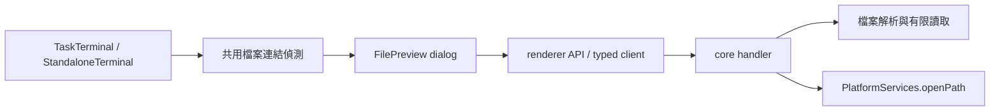
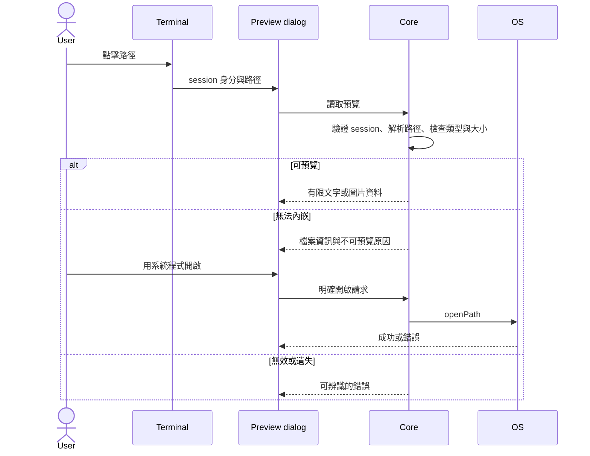

# Terminal file preview plan

Status: implemented and verified on 2026-10-29. The user approved implementation and explicitly requested work on `main`.

## 需求

**目的**：讓使用者能直接查看 agent 或 shell 提到的本機產出，不必先把路徑複製到檔案管理員，也不必先將檔案加入 Artifacts。使用者已確認「點擊路徑、在 VibeFlow 預覽」；其他格式提供系統程式開啟按鈕。

R1. 任務 terminal 與獨立 terminal 都能點擊本機檔案路徑，包含絕對路徑、`~/`、`./`、`../`、有副檔名的裸檔名與本機 `file:` 連結。
R2. 引號中的空白路徑可開啟，常見行號／欄號後綴不會被當成檔名；相對路徑以 terminal 的啟動目錄解析。
R2a. 未加引號但含空白的路徑，以及 agent 自行換行（硬換行加縮排，xterm 不標記為 wrapped）而斷開的路徑可開啟；這類候選有歧義，只在 core 確認拼接後的檔案存在時才成為連結。
R3. 圖片以可縮放的對話框顯示；文字以唯讀內容顯示，Markdown 沿用既有安全 renderer。
R4. 不支援或超過預覽上限的格式顯示說明與「用系統程式開啟」按鈕，只有使用者點擊該按鈕才啟動系統程式。
R5. 檔案不存在、不可讀或不是一般檔案時顯示可理解的錯誤；預覽讀取有大小上限，文字截斷需有提示。
R6. 關閉預覽後 terminal 保有輸出、執行中的 session 與輸入能力；HTTP／HTTPS 連結行為維持現狀。

## 既有慣例（必須遵守）

- 任務與獨立 terminal 共用連結處理 helper，避免兩套點擊行為：`renderer/lib/terminal-links.ts:3`、`renderer/components/standalone-terminal.tsx:5`、`renderer/components/task-terminal.tsx:18`。
- 預覽沿用對話框、圖片縮放與文字呈現的互動：`renderer/components/task-workspace-panel.tsx:670`、`renderer/components/zoomable-image.tsx:32`。
- 主機上的檔案開啟透過 PlatformServices：`packages/core/src/platform.ts:35`；新增入口沿用 handler → typed client → renderer API 的專案慣例。

## 偏離慣例的項目

- 依使用者明確指示直接在 `main` 工作。
- 計畫放在 `docs/features/terminal-file-preview/plan.md`，遵守專案文件位置規則，取代 skill 的根目錄 PLAN.md。
- terminal 的檔案選擇必須攜帶路徑字串。API 同時要求已知 session 身分，由 core 解析目錄，不能由前端傳入任意 cwd；這是既有「只傳 task id」原則對檔案選擇功能的必要延伸。

## 範圍邊界

- 僅 Web UI 的任務與獨立 terminal；不變更 TUI、Jira 登入專用 terminal、卡片資料或 Artifacts 儲存位置。
- 不加入新依賴，不注入 shell hooks，不實作 terminal 圖片協定或檔案編輯器。
- 不追蹤 shell 的 `cd`；相對路徑定義為啟動目錄相對位置，預覽顯示解析後的完整路徑。
- 不把本機檔案經未驗證的 HTTP 靜態路徑暴露；僅透過既有 bridge 請求讀取。

## System Design

### Architecture

本圖回答 terminal 如何共用預覽而不重建 session。



既有節點：terminal 見 `renderer/components/standalone-terminal.tsx:42` 與 `renderer/components/task-terminal.tsx:281`；PlatformServices 見 `packages/core/src/platform.ts:35`。其餘為新增提案。

### Sequence Diagram



### Data Flow / API Contract

以下描述契約形狀，最終名稱由實作決定。

```ts
type FileRequest = { sessionKey: string; path: string }
type PreviewResult =
  | { ok: true; path: string; kind: 'image'; dataUrl: string }
  | { ok: true; path: string; kind: 'text'; text: string; truncated: boolean }
  | { ok: true; path: string; kind: 'binary'; reason: string }
  | { ok: false; error: 'invalid_path' | 'not_found' | 'not_file' | 'unreadable'; message: string }
type OpenResult = { ok: true } | { ok: false; message: string }
```

前端負責從輸出提取候選路徑；core 擁有 session → 啟動目錄的解析，拒絕未知 session、非本機 file URL、NUL 與非檔案類型，執行檔案讀取和 OS 開啟。預覽的候選字串不得作為 shell command 執行。圖片上限 20 MiB；文字最多讀取 256 KiB 並另取少量資料判斷是否截斷，不先載入整份大檔。

### Threading

UI 的請求非同步執行。對話框擁有 loading／內容／錯誤狀態，切換檔案或關閉後忽略舊請求結果；terminal 實例及 session 不隨預覽開關重建。不新增背景輪詢或持久化預覽狀態。

### 審查頁

1. **方案與適用性**：採用 xterm 連結偵測加共用預覽對話框，因為輸出路徑是既有 terminal 到檔案的直接入口。需要在 shell 執行指令就自動彈出檔案，或期待 terminal 直接顯示圖片協定時，此方案不適用。
2. **落點**：連結偵測在 renderer helper，預覽在共用 component，有限讀檔在 core helper；所有橋接變更同步更新 IPC_API_MAP。既有 Artifacts 預覽可參考，但本功能不搬動 Artifact 儲存資料。
3. **可證偽風險預測**：若路徑偵測過寬，最先出現的是一般輸出被誤標為連結；若過窄，則帶空白或換行折返的路徑無法點擊。用負例與 xterm 實際折行案例提早辨識。相對路徑在 `cd` 後可能指錯檔案，因此本版明確顯示解析路徑並以啟動目錄為準。
4. **決策點**：使用者已確認 VibeFlow 內預覽；無未決互動選項。使用者已明確批准開始實作。
5. **證據標記**：現有 URL helper 僅接受 HTTP／HTTPS（`renderer/lib/terminal-links.ts:3`）；Artifact 預覽為現有可沿用互動（`renderer/components/task-workspace-panel.tsx:670`）；standalone 啟動目錄由 core 決定並保留（`packages/core/src/service.ts:800`）。新連結偵測的匹配率尚未驗證，需由驗收確認。

## 驗收清單

- A1 ← R1：單元測試覆蓋所有指定路徑形狀；互動驗收在任務 terminal 與獨立 terminal 各點擊圖片路徑，確認 dialog 顯示該圖片。
- A2 ← R2：測試引號空白、行欄後綴、相對位置與非路徑負例；互動驗收包含 xterm 換行折返的長路徑。
- A2a ← R2a：單元測試覆蓋未加引號空白、單字中途硬換行、空白處換行、後續文字不被吞入、web URL 排除與重疊取最長；core 測試 `terminal:existingFiles` 只接受一般檔案與已知 session；E2E 在真實 PTY 點擊空白路徑與硬換行路徑的兩列，皆開啟同一圖片。
- A3 ← R3：互動驗收縮放圖片、開啟文字及 Markdown，斷言內容與對應 fixture 一致且未插入可執行 HTML。
- A4 ← R4：不支援格式與超大圖片顯示替代操作；fake platform 斷言只有明確 open 呼叫才執行 openPath，並覆蓋 OS 失敗。
- A5 ← R5：core 測試遺失檔案、資料夾、特殊檔案、無效 session、不可讀取與超大文字，確認錯誤或截斷；UI 顯示對應訊息。
- A6 ← R6：互動驗收關閉 dialog 後輸入唯一標記並看到 shell 回應，確認先前輸出仍存在；URL helper 測試 HTTP／HTTPS 開啟與不支援協定拒絕。
- A7 ← 範圍邊界：執行受影響 typechecks、完整 npm test、Web build 與 E2E；在 throwaway store 的 live Web UI 驗證操作，以 375／768／1440 寬度截圖檢查 dialog 與水平溢出。

## 實作階段

- S1：加入有限讀檔與明確系統開啟的 core／bridge 契約，以及必要測試與 API 文件（A4、A5）。
- S2：任務與獨立 terminal 共用路徑偵測和預覽，完成互動與回歸驗收（A1、A2、A3、A6、A7）。

每階段通過對應驗收後 commit；不 push。


## Verification results

- `npx tsc --noEmit -p tsconfig.json`: passed.
- `npx tsc --noEmit -p renderer/tsconfig.json`: passed.
- `npm test`: 465 passed, no failures or skips.
- `node scripts/run-tests.mjs ./test/terminal-files.test.mjs ./test/service.test.mjs`: 53 passed. Additional permission and special-file cases passed in the focused terminal-files suite.
- `npm run build:web`: passed.
- `npm run test:e2e`: 3 passed against real HTTP/WebSocket hosts, including a real PTY with a fake agent. Covered task and standalone previews, quoted filenames, a wrapped path, Markdown HTML safety, missing files, unsupported formats, image zoom, unchanged web links, and continued terminal input.
- Live screenshots at 375 / 768 / 1440 were individually inspected after dialog entrance settled. No dialog overlap, clipping, text truncation, or horizontal overflow was observed. The dialog mounts through a portal to avoid terminal ancestor layout affecting its position; a narrow react-dom type declaration supplies the existing runtime API without adding a dependency.
- `visual-parity flow`: 6/6 steps passed, recording the click → image preview → close path. Evidence filenames: `a1-terminal-image-preview.mp4`, `a1-terminal-image-preview.png`, and `a7-terminal-file-preview-{375,768,1440}.png`. Evidence stays outside the repository.
- Native OS application launch was verified through a fake PlatformServices implementation, including OS errors; no external desktop application was launched in the browser checks. Preview binary fallback was exercised in the browser.

Relative paths deliberately continue to use the launch directory, including after shell `cd`. No shell integration or new dependencies were added. Changes are committed locally on main; nothing was pushed.

## Follow-up: spanning paths (2026-10-29)

Agent output (Claude Code's Ink renderer) inserts its own newlines and indentation when a line exceeds the width, so xterm's `isWrapped` join does not see one line; unquoted spaces also split tokens. The link provider now reads the hovered logical line plus 3 neighbours on each side, generates candidates that cross single spaces and line breaks (both "no separator" and "space" variants, up to 3 breaks and 12 words), and asks core which exist through `terminal:existingFiles` (stat only, at most 128 candidates, session-scoped like the other two channels). The longest existing candidate wins over overlapping shorter matches; with no spanning candidate the provider answers synchronously as before.

- `npx tsc --noEmit -p tsconfig.json` and `npx tsc --noEmit -p renderer/tsconfig.json`: passed.
- `npm test`: 467 passed.
- `npm run build:web`: passed.
- `npm run test:e2e`: 3 passed, including clicks on an unquoted spaced path and on both rows of a hard-wrapped path.
